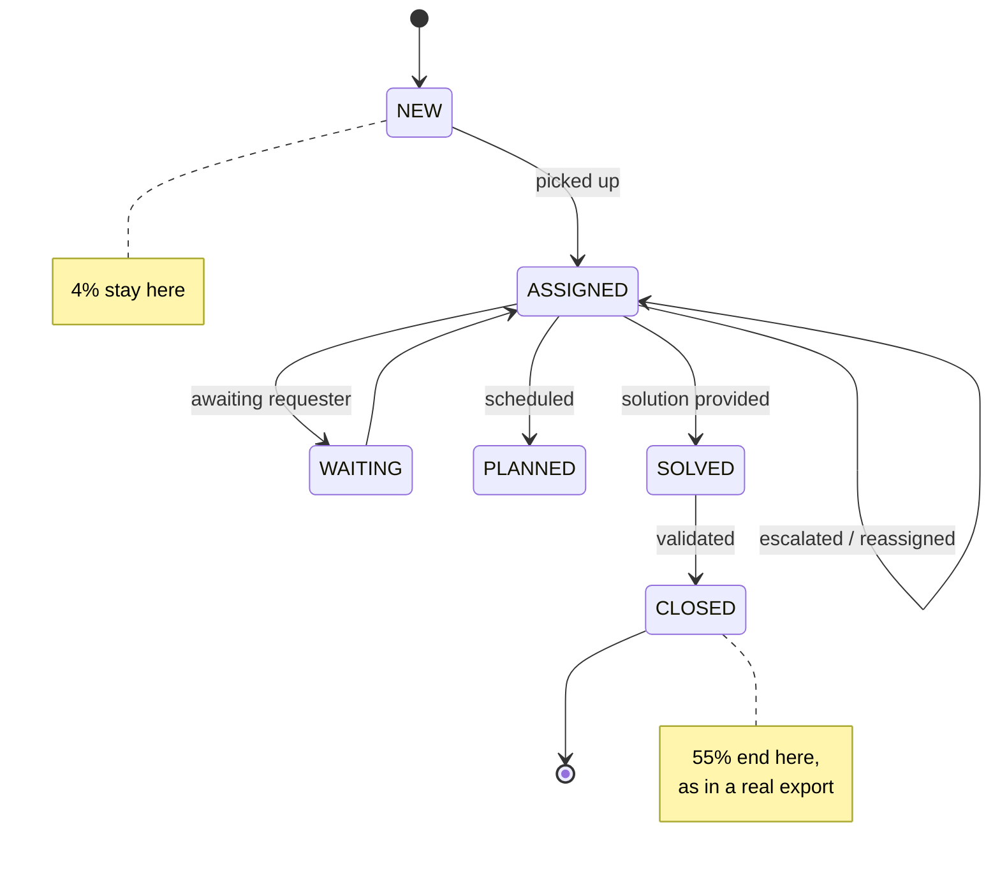

<div align="center">

# glpi-testkit

**Generate realistic ITIL tickets for GLPI — in French, Arabic and Darija — without touching a single real ticket.**

[](https://github.com/novagiosAI/glpi-testkit/actions/workflows/ci.yml)
[](https://pypi.org/project/glpi-testkit/)
[](https://pypi.org/project/glpi-testkit/)
[](LICENSE)
[](https://peps.python.org/pep-0561/)

*Seeded and reproducible. No dependencies.*

</div>

---

## Why

You need ticket data — to demo a plugin, load-test an instance, or train a
classifier. Real tickets are full of personal data and usually cannot leave the
building, which stops the project before it starts.

The usual workaround is a loop that writes *"Test ticket 1, Test ticket 2"*.
That tells you nothing: no priority distribution, no escalations, no language
mix, nothing a model or a dashboard could learn from.

This package generates tickets that behave like real ones, and that **contain no
personal data by construction** — there is no source dataset to leak from.

## Installation

```bash
pip install glpi-testkit
```

## Use it

```bash
# 1000 tickets, reproducible, with a distribution summary
glpi-testkit -n 1000 --seed 42 --stats -o tickets.json

# Darija only, VPN incidents only
glpi-testkit -n 200 -l ary -c network.vpn -o darija-vpn.json

# Ready to POST to the GLPI API
glpi-testkit -n 50 --glpi-input -o payload.json

# See the catalogue
glpi-testkit --list-categories
```

```python
from glpi_testkit import TicketGenerator, Language

generator = TicketGenerator(seed=42, languages=[Language.FRENCH, Language.DARIJA])
tickets = generator.generate(1000)

print(tickets[0].name, tickets[0].priority.name, tickets[0].language)
print(tickets[0].to_glpi_input())  # ready for the GLPI REST API
```

## What makes the data usable

### It follows GLPI's own priority rules

GLPI does not average urgency and impact — it looks the pair up in a
configurable 5×5 matrix. The default below was **read out of a stock GLPI 11
install**, and the arithmetic fallback in
`CommonITILObject::computePriority` is reproduced too, so a ticket generated
here carries the priority a real GLPI would have computed.

```
         impact:  1  2  3  4  5
urgency 1:        1  1  2  2  2
urgency 2:        1  2  2  3  3
urgency 3:        2  2  3  4  4
urgency 4:        2  3  4  4  5
urgency 5:        2  3  4  5  5
```

```python
from glpi_testkit import compute_priority

compute_priority(urgency=4, impact=5)  # Level.VERY_HIGH
```

Pass your own matrix if you have customised yours:
`TicketGenerator(priority_matrix=my_matrix)`.

### The lifecycle holds together

Every ticket carries a coherent history, which is what makes the data worth
training on: timestamps are ordered, only assigned tickets have an assignee,
only solved ones have a solve date, delay statistics match their dates, and
high-priority tickets get escalated and bounce between groups.



### SLA pressure is a dial, not an accident

`sla_pressure` scales resolution time against each category's target. Measured
over 3000 tickets across five seeds:

| `sla_pressure` | tickets breaching SLA |
|---|---|
| **0.2** (default) | **13–14%** — a desk meeting its targets |
| 0.35 | 23% |
| 0.5 | 32% |
| 1.0 | 49% — a team in crisis |

### The three languages are written properly

French, Modern Standard Arabic, and Darija in both Arabic script and Latin
letters (*arabizi*) — because that is what a Moroccan service desk actually
receives.

```
fr   Le scanner de l'agence de Rabat est hors service depuis deux semaines.
ar   تظهر الطابعة رسالة انحشار الورق رغم أن الدرج فارغ.
ary  l vpn kat9ta3 kol chi 10 d daqayq, tan7iyed men SAP kol mrra.
```

Slot substitution is the easy way to get variety and the easy way to produce
broken grammar — *"un imprimante"*, *"du agence"*, *"de le CRM"*, or an Arabic
feminine verb against a masculine noun. Every slot therefore carries its own
article, preposition and gender, and a dedicated test suite scans thousands of
generated sentences for each fault class.

Darija written in Latin letters is deliberately left lowercase: users really do
type it that way, and that is what a classifier will meet in production.

> **Native review welcome.** The Arabic and Darija phrasings are written to be
> idiomatic, but a native reviewer will always improve them — corrections are
> the single most useful pull request this project can receive.

## Load it into GLPI

With [`glpi-rest`](https://github.com/novagiosAI/glpi-rest):

```python
from glpi_rest import GLPIClient
from glpi_testkit import TicketGenerator

tickets = TicketGenerator(seed=42).generate(200)

with GLPIClient(url, app_token=..., user_token=...) as glpi:
    for ticket in tickets:
        glpi.add_item("Ticket", ticket.to_glpi_input())
```

`to_glpi_input()` emits only the fields the API accepts on creation, with GLPI's
integer enums and `Y-m-d H:i:s` timestamps. `to_dict()` gives you everything
instead — events, delay statistics, requester and assignee — for offline work.

## The catalogue

| Key | Type | SLA | Covers |
|---|---|---|---|
| `network.vpn` | incident | 4 h | VPN drops, connection failures |
| `hardware.printer` | incident | 24 h | paper jams, dead devices |
| `account.password` | request | 2 h | resets, locked accounts |
| `software.crash` | incident | 8 h | application crashes |
| `email.mailbox` | incident | 8 h | full mailboxes, attachments |
| `request.equipment` | request | 72 h | new starters, replacements |
| `security.phishing` | incident | 2 h | suspicious mail reports |

Urgency and impact ranges are set per category, so a jammed printer never
outranks a security incident by chance.

## Privacy

There is no source dataset. Every name, phrase and reference in this package was
invented, and a test asserts the output contains nothing shaped like a Moroccan
phone number, RIB or ICE.

That is the point: it lets you build and publish on ticket data **without ever
processing a customer's**. If you also need to clean a real export, see
[`glpi-anonymizer`](https://github.com/novagiosAI/glpi-anonymizer).

## Limitations

- Seven categories today. Real service desks have dozens — new catalogue
  entries are the most useful contribution.
- Text is template-based, so lexical variety is bounded by the catalogue. It is
  built for structure, volume and language mix, not for fooling a human reader
  into thinking a person wrote it.
- Timestamps ignore business hours and public holidays.

## The suite

`glpi-testkit` is one of six packages Novagios publishes for ITSM and Arabic
NLP. Each one stands on its own; together they run from pulling tickets out of
GLPI to a trained classifier, without a single real ticket ever being used.

| Package | What it does |
|---|---|
| [`glpi-rest`](https://github.com/novagiosAI/glpi-rest) | Typed client for the GLPI REST API, with automatic recovery of an expired session |
| [`glpi-anonymizer`](https://github.com/novagiosAI/glpi-anonymizer) | Strips personal data from ticket exports; validates Moroccan check digits before masking |
| [`presidio-mena`](https://github.com/novagiosAI/presidio-mena) | The same Moroccan identifiers, as Microsoft Presidio recognizers |
| **`glpi-testkit`** | Synthetic ITIL tickets in French, Arabic and Darija — no source data, so nothing can leak — **you are here** |
| [`glpi-ticket-triage`](https://github.com/novagiosAI/ticket-triage) | Category and priority classifier; CPU only, 0.5 MB model |
| [`arabizi`](https://github.com/novagiosAI/arabizi) | Moroccan Arabizi transliteration and word-level language detection |

All six at once:

```bash
pip install glpi-rest glpi-anonymizer presidio-mena glpi-testkit glpi-ticket-triage arabizi
```

## Contributing

See [CONTRIBUTING.md](CONTRIBUTING.md).

```bash
git clone https://github.com/novagiosAI/glpi-testkit.git
cd glpi-testkit
python -m venv .venv && source .venv/bin/activate   # Windows: .venv\Scripts\activate
pip install -e ".[dev]"
pytest
```

## License

[Apache License 2.0](LICENSE) — free for commercial use.

---

<div align="center">

Built and maintained by **[Novagios](https://www.novagios.com)** — IT services, AI and ITSM.

</div>
